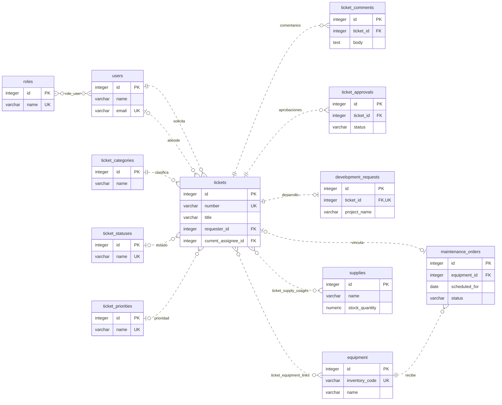

# Diagrama entidad–relación resumido — ZOLIC

Un único diagrama con las **12 entidades principales** y **13 relaciones esenciales** del sistema.

[Abrir diagrama](DIAGRAMA_ENTIDAD_RELACION.html) · [Imagen SVG](erd/resumen.svg)

Se omiten tablas auxiliares, auditoría y campos secundarios. Los administradores y técnicos son usuarios con roles. Las relaciones N:M condensan `role_user`, `ticket_equipment_links` y `ticket_supply_usages`; no representan claves foráneas directas.

Actualizar: `php docs/erd/generar.php` y luego `node docs/erd/renderizar.cjs /ruta/a/@viz-js/viz`. Para renderizar el modelo completo se puede añadir `--complete`.
